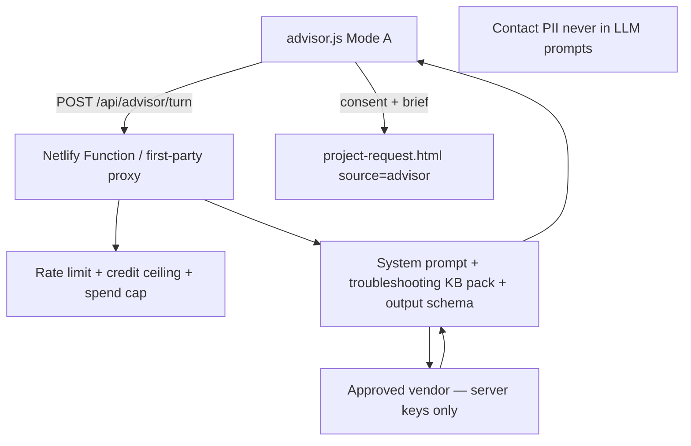

# Phase B Architecture & Implementation Plan (PLAN ONLY)

**Date:** 2026-11-23  
**Authority:** `qa-m6a/M6C-phase-b-adaptive-technical-support.md` + M6A §8 / M6E  
**Status:** Documentation only — **do not implement** until separate Owner/Atlas approval

## Goal

Optional **server-side** Adaptive Technical Support LLM that deepens Mode A troubleshooting while preserving Phase A deterministic qualification, consent, and human handoff.

## Architecture (target)

## Work packages (when approved)

| # | Package | Notes |
|---|---------|-------|
| B1 | Provider selection + account | Mid-tier chat model; keys in host env only |
| B2 | `POST /api/advisor/turn` | Session id ephemeral; issue/follow-up classification; max turns/tokens |
| B3 | Server credit enforcement | Reject 4th free issue even if client lies |
| B4 | Rate / spend ceilings | Per-IP rolling window + daily USD/token hard cap + kill-switch |
| B5 | Prompt-injection defenses | Strip tool/system override attempts; refuse credential fishing; no remote execution claims |
| B6 | Retention | Minimal logs; no secret retention; align privacy before launch |
| B7 | Escalation | Soft-cap + stuck paths → `it-consulting` / human; degrade to Phase A on failure |
| B8 | Error handling | Timeouts → Phase A step pack; provider down → mailto + human |
| B9 | Eval harness | §8 acceptance tests B-A* / B-U* / B-C* / B-S* / B-R* / B-T* from M6C addendum |
| B10 | CSP review | Prefer same-origin function (`connect-src 'self'`); forbid browser→vendor |

## Security non-negotiables

- No browser-exposed API keys  
- No passwords/MFA/recovery requested or stored  
- No execution of customer commands  
- No fabricated “I checked your machine” results  
- No lead transmit without consent  
- Kill-switch returns users to Phase A / human without breaking Mode B

## Estimated cost (estimates only — not guarantees)

Per M6C §10: roughly **~$0.05–$0.25** typical maxed free session on a small/mid model; abuse controls mandatory before public launch.

## Gate

**STOP** — Phase B coding requires explicit Atlas/Owner approval separate from Phase A local recovery.
