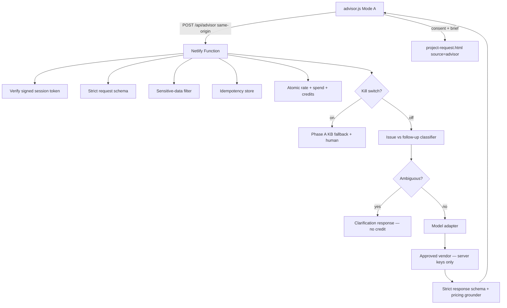

# Phase B Technical Architecture — `/api/advisor` (DESIGN ONLY)

**Date:** 2026-11-23  
**Status:** Documentation only — **do not implement** until separate Atlas / Owner approval  
**Endpoint:** Same-origin Netlify Function `POST /api/advisor` (and optional `GET` health/kill status)  
**Client:** `advisor.js` Mode A Adaptive Technical Support only  
**Non-goals this round:** Live AI calls, credential provisioning, production env vars, coding the function

## 1. System context



## 2. Single function contract

**Path:** `/.netlify/functions/advisor` → redirected as `/api/advisor`  
**Methods:** `POST` primary; `OPTIONS` for CORS preflight if ever needed (prefer same-origin only).

### 2.1 Request schema (strict)

```json
{
  "sessionToken": "string (signed)",
  "idempotencyKey": "uuid-v4",
  "action": "start_session | turn | classify | escalate | summary",
  "clientIssueHint": "new | followup | unknown",
  "message": "string (maxInputChars)",
  "activeIssueId": "string|null",
  "context": { "os": "string?", "device": "string?", "app": "string?" },
  "uiCreditsClaim": "number (advisory only — never trusted)"
}
```

Reject unknown fields. Cap `message` length server-side (`maxInputTokens` / chars). Strip control characters.

### 2.2 Response schema (strict)

```json
{
  "ok": true,
  "sessionToken": "rotated-or-same",
  "classification": "new_issue | followup | clarification | soft_cap | escalate | refuse | fallback",
  "creditsRemaining": 0,
  "assistantMessage": "string",
  "steps": [{ "title": "string", "body": "string" }],
  "pricing": [{ "serviceId": "it-consulting", "display": "$110/hour", "source": "catalog" }],
  "serviceHint": "it-consulting",
  "requiresConsentForLead": true,
  "killSwitch": false,
  "warnings": ["string"]
}
```

Pricing arrays are **server-authoritative** from the approved catalog — never model-invented.

## 3. Provider-independent model adapter

```text
interface ModelAdapter {
  id: string
  complete(input: AdapterRequest): Promise<AdapterResult>
}
AdapterRequest = { system, messages, maxInputTokens, maxOutputTokens, temperature }
AdapterResult  = { text, usage: { in, out }, finishReason, vendorRequestId }
```

- Concrete adapters: `OpenAIAdapter`, `AnthropicAdapter`, `StubAdapter` (tests).  
- Function selects adapter via `ADVISOR_MODEL_VENDOR` env — **no browser keys**.  
- Streaming optional later; v1 returns one JSON turn.  
- On vendor failure / timeout → `classification: fallback` with Phase A knowledge-pack steps.

## 4. Signed session tokens

- HMAC-SHA256 (or Ed25519) over `{ sid, iat, exp, creditsUsed, activeIssueId, spendMicros }`.  
- Secret: `ADVISOR_SESSION_HMAC` in Netlify env only.  
- Short TTL (e.g. 2–4h); rotate payload on each successful credit-changing turn.  
- Tamper / expiry → new anonymous session (credits reset) or hard refuse under abuse flags.

## 5. Server-enforced issue credits

| Rule | Enforcement |
|------|-------------|
| 3 free issues / session | Server counter in transactional store |
| Follow-ups | Classifier + activeIssueId continuity — **no** decrement |
| 4th new issue | Reject with soft-cap payload |
| Active walkthrough at 0 remaining | Allow turns classified `followup` only |
| Client `uiCreditsClaim` | Ignored for authorization |

Ambiguous new-vs-follow-up → `clarification` response (no credit) until user confirms.

## 6. Atomic rate & spending controls

| Control | Mechanism |
|---------|-----------|
| Per-IP / coarse fingerprint rate | Atomic increment per rolling window |
| Per-session turn / token ceiling | Atomic + schema caps |
| Daily USD ceiling | Atomic spend accumulator (pre-debit estimate, post-debit actual) |
| Monthly USD ceiling | Same, calendar month key |
| Kill switch | `ADVISOR_LLM_ENABLED=false` or Blobs/flag key `advisor/kill` |

**Critical:** Ordinary read-modify-write on Netlify Blobs is **not** sufficient (see Session Storage Feasibility). Credits, rate, and spend must use a store with **demonstrable atomic increment** (or serializable transactions). If unavailable at ship time → **do not** enable public LLM Mode A.

## 7. Request idempotency

- Client sends `Idempotency-Key` / body `idempotencyKey`.  
- Store mapping `key → response` with `onlyIfNew`-style create.  
- Replays return cached response; **no** double credit/spend debit.  
- TTL ≥ session TTL.

## 8. Token & cost ceilings

- `maxInputTokens`, `maxOutputTokens` per turn (env + hard defaults).  
- Truncate / reject oversized pastes before vendor call.  
- Pre-flight estimated cost; if daily/monthly remaining < estimate → degrade to Phase A.

## 9. Kill switch & Phase A fallback

1. Global flag off → Mode A LLM unavailable; Mode B commercial Phase A unchanged.  
2. Provider outage → return KB step pack + human / `it-consulting` route.  
3. Never claim “I checked your machine.”

## 10. Sensitive-data filtering

- Pre-vendor filter (same family as Phase A `SECRET_RE`, expanded).  
- On hit: refuse, instruct rotation, do **not** forward to model, do **not** persist raw secret.  
- Redact logs.

## 11. Minimal conversation retention

- Prefer ephemeral: session blob TTL hours, not days.  
- Store: issue ids, classifications, step indices, usage counters — **not** full secret-bearing transcripts by default.  
- Contact PII never in LLM prompts; lead path remains consent + project-request only.  
- Align retention copy with Owner-approved privacy before public LLM launch.

## 12. Catalog grounding & authoritative pricing

- Server loads approved 12-service catalog (from `advisor-kb.json` / packages extract).  
- Model may **suggest** service ids; response layer overwrites `pricing[]` from catalog.  
- Invented prices / 13th services stripped.

## 13. Human escalation

Available from every Adaptive Support state via UI chrome; server `action: escalate` returns `serviceHint` (`it-consulting` default; `cybersecurity` / `care-plan` / `other` when indicated) without bypassing consent.

## 14. CSP

Prefer same-origin `/api/advisor` so `connect-src 'self'` remains valid. Browser must never call vendor hosts.

## 15. Implementation packages (when approved)

| # | Package |
|---|---------|
| B1 | Function scaffold + schemas + adapter interface |
| B2 | Session tokens + idempotency |
| B3 | Atomic credit / rate / spend store (non-Blobs RMW) |
| B4 | Classifier + clarification |
| B5 | Vendor adapter + grounding + filters |
| B6 | Kill switch + Phase A fallback |
| B7 | Eval harness (≥50 cases; ≥15 injection) |
| B8 | Privacy / retention Owner sign-off |
| B9 | Staged dogfood behind flag |

**STOP** — coding requires explicit Atlas / Owner approval separate from Phase A.
